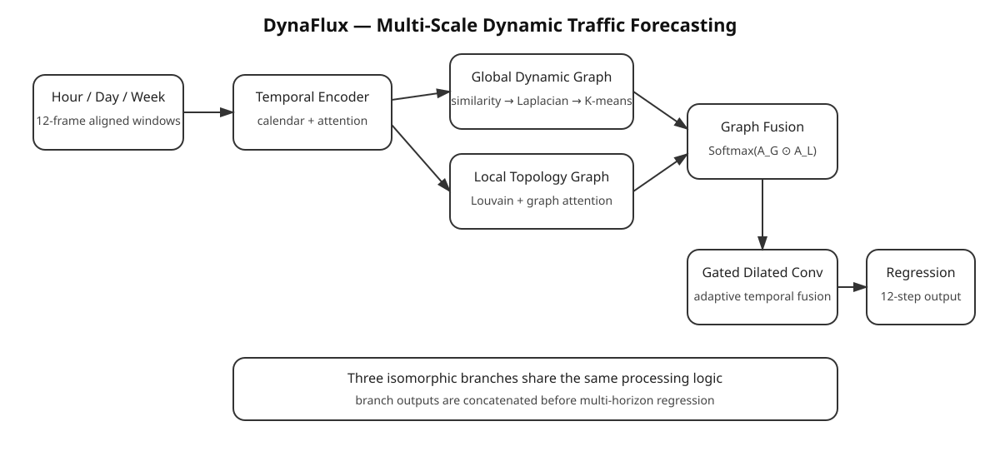

# DynaFlux

**Multi-Scale Dynamic Graph Learning for Traffic Flow Forecasting**  
**面向交通流量预测的多尺度动态图学习框架**

[中文说明](README_CN.md) · [English](README_EN.md)

DynaFlux is a PyTorch traffic-flow forecasting framework that jointly models multi-period temporal patterns, global flow similarity, local road topology, and gated dilated temporal dynamics. The default task uses 12 historical 5-minute frames to forecast the next 12 frames, with aligned one-hour, one-day, and one-week context.

DynaFlux 是一个基于 PyTorch 的交通流量预测框架，联合建模多周期时间模式、全局流量相似关系、局部道路拓扑关系以及门控扩张时序动态。默认任务使用 12 个历史 5 分钟时间帧预测未来 12 帧，并同时引入前一小时、前一日与前一周的对齐信息。



## Core pipeline / 核心流程

1. **Multi-period temporal encoding / 多周期时间编码** — hour, day and week aligned windows are independently encoded by Transformer-style temporal encoders with calendar and node-adaptive embeddings.
2. **Global dynamic association / 全局动态关联** — node sequences are compared with Euclidean distance, transformed by `s = 1 / (1 + d)`, converted to a normalized graph Laplacian, spectrally embedded, and grouped by K-means.
3. **Local topology association / 局部拓扑关联** — road-distance edges are converted into a weighted graph, Louvain community discovery supplies regional structure, and topology-masked graph attention learns neighbor importance.
4. **Multi-scale graph fusion / 多尺度图融合** — the global co-cluster graph and local attention graph are fused by element-wise interaction followed by row-wise softmax.
5. **Adaptive gated convolution / 自适应门控卷积** — graph-aggregated features and residual traffic features are fused by an MLP, then processed by dilated and standard causal 1D convolutions. A sigmoid gate adaptively combines both branches.
6. **Multi-horizon regression / 多步回归预测** — hour/day/week branch features are fused and mapped to the next 12 traffic-flow frames.

## Quick start / 快速开始

```bash
python -m venv .venv
# Windows: .venv\\Scripts\\activate
# Linux/macOS: source .venv/bin/activate
pip install -r requirements.txt
pip install -e .
```

Place PEMS-style files under `data/raw/`, then train:

```bash
python scripts/train.py --config configs/pems08.yaml
```

Run the synthetic smoke test without external data:

```bash
python scripts/demo_synthetic.py
```

Run tests:

```bash
pytest -q
```

## Default research configuration / 默认实验配置

- Input: 12 × 5 min = 60 min
- Forecast: 12 × 5 min = 60 min
- Period offsets: 1 day = 288 steps, 1 week = 2016 steps
- Split: 60% / 20% / 20%
- Optimizer: Adam
- Initial learning rate: 0.001
- Batch size: 16
- Temporal encoder: 3 layers, 4 heads
- Dropout: 0.3
- Gradient clipping: 5.0
- Huber regression loss
- Graph parameters: `sigma=1.0`, `resolution=0.5`, `similarity_threshold=0.5`
- PEMS08 default spectral groups: 41

## Evaluation / 评估

The evaluator reports MAE, RMSE, MAPE and R² at 15, 30, 45 and 60 minutes, corresponding to the 3rd, 6th, 9th and 12th 5-minute prediction steps.

评估模块输出 15、30、45、60 分钟四个预测时效下的 MAE、RMSE、MAPE 与 R²，分别对应未来第 3、6、9、12 个 5 分钟时间步。

## Repository layout / 仓库结构

```text
dynaflux/
├── assets/
│   └── architecture.svg
├── configs/
│   ├── pems04.yaml
│   └── pems08.yaml
├── data/
│   └── README.md
├── docs/
│   ├── ALGORITHM_CN.md
│   └── ALGORITHM_EN.md
├── dynaflux/
│   ├── data/
│   │   ├── dataset.py
│   │   ├── graph.py
│   │   ├── io.py
│   │   └── preprocessing.py
│   ├── engine/
│   │   ├── evaluator.py
│   │   └── trainer.py
│   ├── models/
│   │   ├── adaptive_conv.py
│   │   ├── dynamic_graph.py
│   │   ├── gat.py
│   │   ├── model.py
│   │   └── temporal.py
│   └── utils/
│       ├── checkpoint.py
│       ├── config.py
│       ├── metrics.py
│       └── seed.py
├── scripts/
│   ├── demo_synthetic.py
│   ├── evaluate.py
│   ├── predict.py
│   ├── prepare_pems.py
│   └── train.py
├── tests/
├── .gitignore
├── LICENSE
├── pyproject.toml
└── requirements.txt
```

## Data contract / 数据约定

The traffic tensor uses `[time, node, feature]`. The default configuration reads feature channel `0` as flow. Edge data uses `from,to,cost`, where `cost` is the road distance or another non-negative spatial cost. Raw benchmark data is not bundled.

交通数据张量采用 `[时间, 节点, 特征]`；默认读取第 0 个特征通道作为流量。空间边文件采用 `from,to,cost`，其中 `cost` 表示道路距离或其他非负空间代价。仓库不内置原始基准数据。

## License

MIT
